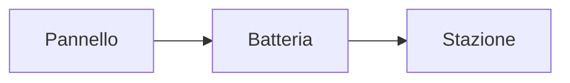

Charta legge CommonMark e le estensioni di GitHub (GFM), più alcune estensioni comuni negli editor di note. Tutto resta testo: un altro editor Markdown legge lo stesso file.

## Di base

| Elemento | Si scrive |
|---|---|
| Titoli | da `# Titolo` a `###### Titolo` |
| Grassetto · corsivo | `**grassetto**` · `*corsivo*` |
| Barrato | `~~barrato~~` |
| Evidenziato | `==evidenziato==` |
| Codice in linea | `` `codice` `` |
| Link · immagine | `[testo](https://…)` · `` |
| Indirizzi nudi | `https://esempio.it` diventa un link |
| Elenchi | `- voce`, `1. voce` |
| Voci da spuntare | `- [ ] da fare`, `- [x] fatto` |
| Citazione | `> testo` |
| Separatore | `---` |

## Tabelle

Le tabelle di GitHub, con l'allineamento delle colonne nella riga dei trattini (`:---`, `:---:`, `---:`). Nel WYSIWYG la tabella si vede disegnata; quando il cursore ci entra torna testo. **Formatta tabella** allinea le colonne anche nel testo. Comandi e tasti in [Formato, tabelle e scrittura](/progetti/charta/docs/formato-tabelle-e-scrittura).

## Blocchi di codice

Tre apici inversi e il nome del linguaggio:

````markdown
```python
print("ciao")
```
````

I colori valgono per una trentina di linguaggi, tra cui Swift, Kotlin, Java, JavaScript e TypeScript, JSON, Python, Ruby, Go, Rust, C, C++, Objective-C, C#, PHP, shell, SQL, YAML, TOML, HTML e XML, CSS, diff, Lua, Dart, Scala, R, LaTeX, Dockerfile, Makefile, PowerShell e GraphQL. Il linguaggio si cambia anche dal menu del blocco nella barra di stato.

## Formule

Formule LaTeX disegnate con KaTeX, incluso nell'app (niente rete):

- nel testo: `$E = mc^2$`;
- a parte, su più righe:

```markdown
$$
\int_0^1 x^2 \, dx = \frac{1}{3}
$$
```

Un `$` seguito da uno spazio non apre una formula, così i prezzi come «5 $ e 10 $» restano testo.

## Diagrammi Mermaid

Un blocco di codice con il linguaggio `mermaid` diventa un diagramma (flussi, sequenze, grafici e gli altri tipi di Mermaid):

````markdown

````

Mermaid è incluso nell'app e funziona senza rete. Nel tema scuro i diagrammi si ridisegnano con i colori scuri.

## Collegamenti tra le note

Nelle cartelle: `[[Nome della nota]]` collega un'altra nota della cartella, senza estensione. Si può puntare a un titolo con `[[Nota#Titolo]]` e mostrare un altro testo con `[[Nota|testo]]`, anche insieme: `[[Nota#Titolo|testo]]`. Vedi [Cartelle e note collegate](/progetti/charta/docs/cartelle-e-note-collegate).

## Note a piè di pagina

```markdown
Una frase con una nota.[^1]

[^1]: Il testo della nota.
```

L'anteprima mette le note in fondo, con i link di andata e ritorno.

## Citazioni speciali

Le citazioni di GitHub con un tipo: `> [!NOTE]`, `> [!TIP]`, `> [!IMPORTANT]`, `> [!WARNING]` e `> [!CAUTION]`. Il tipo fa da titolo e la barra a sinistra prende il suo colore, sia nel WYSIWYG sia nell'anteprima.

```markdown
> [!TIP]
> Il gateway tiene gli ultimi 500 pacchetti.
```

## Front matter

Un blocco YAML all'inizio del file, tra due righe `---`. Charta lo mostra in grigio e lo lascia com'è. Legge alcune chiavi: l'obiettivo di parole (`goal:`, anche `obiettivo:` o `word-goal:`) e, per l'esportazione in Word ed EPUB, `title`, `author` e `lang` (vedi [Esportazione e stampa](/progetti/charta/docs/esportazione-e-stampa)).

```markdown
---
title: Stazione meteo
goal: 1500
---
```

## Sommario

Un paragrafo con solo `[TOC]` diventa, nell'anteprima e nelle esportazioni, l'elenco dei titoli del documento con i link.
