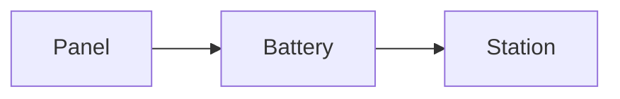

Charta reads CommonMark and GitHub's extensions (GFM), plus a few extensions common in note editors. Everything stays text: any other Markdown editor reads the same file.

## Basics

| Element | Written as |
|---|---|
| Headings | `# Heading` to `###### Heading` |
| Bold · italics | `**bold**` · `*italics*` |
| Strikethrough | `~~strikethrough~~` |
| Highlight | `==highlight==` |
| Inline code | `` `code` `` |
| Link · image | `[text](https://…)` · `` |
| Bare URLs | `https://example.com` becomes a link |
| Lists | `- item`, `1. item` |
| Checklists | `- [ ] to do`, `- [x] done` |
| Quote | `> text` |
| Divider | `---` |

## Tables

GitHub tables, with column alignment in the dash row (`:---`, `:---:`, `---:`). In WYSIWYG the table is drawn; when the cursor enters it, it turns back into text. **Format Table** aligns the columns in the text too. Commands and keys in [Formatting, tables and writing](/en/projects/charta/docs/formatting-tables-and-writing).

## Code blocks

Three backticks and the language name:

````markdown
```python
print("hello")
```
````

Colors work for about thirty languages, including Swift, Kotlin, Java, JavaScript and TypeScript, JSON, Python, Ruby, Go, Rust, C, C++, Objective-C, C#, PHP, shell, SQL, YAML, TOML, HTML and XML, CSS, diff, Lua, Dart, Scala, R, LaTeX, Dockerfile, Makefile, PowerShell and GraphQL. You can also change the language from the block menu in the status bar.

## Math

LaTeX math rendered with KaTeX, bundled in the app (no network):

- inline: `$E = mc^2$`;
- as a block, over several lines:

```markdown
$$
\int_0^1 x^2 \, dx = \frac{1}{3}
$$
```

A `$` followed by a space doesn't start a formula, so prices like "5 $ and 10 $" stay text.

## Mermaid diagrams

A code block with the `mermaid` language becomes a diagram (flowcharts, sequences, charts and the other Mermaid types):

````markdown

````

Mermaid is bundled in the app and works without a network. In the dark theme, diagrams are redrawn in dark colors.

## Links between notes

In folders: `[[Note name]]` links another note in the folder, without the extension. Point to a heading with `[[Note#Heading]]` and show different text with `[[Note|text]]`, or both: `[[Note#Heading|text]]`. See [Folders and linked notes](/en/projects/charta/docs/folders-and-linked-notes).

## Footnotes

```markdown
A sentence with a footnote.[^1]

[^1]: The text of the footnote.
```

The preview puts footnotes at the end, with links back and forth.

## Callouts

GitHub quotes with a type: `> [!NOTE]`, `> [!TIP]`, `> [!IMPORTANT]`, `> [!WARNING]` and `> [!CAUTION]`. The type becomes the title and the bar on the left takes its color, both in WYSIWYG and in the preview.

```markdown
> [!TIP]
> The gateway keeps the last 500 packets.
```

## Front matter

A YAML block at the start of the file, between two `---` lines. Charta shows it in gray and leaves it as it is. It reads a few keys: the word goal (`goal:`, also `obiettivo:` or `word-goal:`) and, for Word and EPUB export, `title`, `author` and `lang` (see [Export and print](/en/projects/charta/docs/export-and-print)).

```markdown
---
title: Weather station
goal: 1500
---
```

## Table of contents

A paragraph with only `[TOC]` becomes, in the preview and in exports, the list of the document's headings with links.
